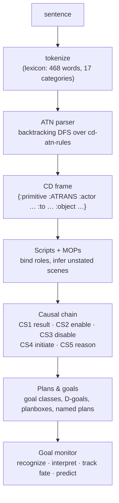

# Schanker

An exploration of **Roger Schank's Conceptual Dependency (CD) theory** for natural language
understanding, built in Clojure on an **Augmented Transition Network (ATN) parser**.

Most modern NLP learns meaning statistically. Conceptual Dependency took the opposite bet,
in the 1970s: represent *meaning* explicitly, in a small fixed vocabulary, independently of the
words used to express it. This project rebuilds that tradition from the bottom up to see how far
it goes:

1. an ATN parses sentences into CD frames;
2. scripts fill in the events a story leaves unsaid;
3. causal links explain *why* things happen;
4. plans and goals connect what characters want to what they do.

> **Status: exploration.** All 54 tests (197 assertions) pass, and every example below is real
> output. The grammar covers a deliberately small set of sentence shapes; see
> [Scope and limitations](#scope-and-limitations). A [web UI](#web-ui) lets you try the parser in
> a browser.

## The idea in one example

```text
"John went to the restaurant"  +  "John ate the lobster"
```

From these two sentences, the system works out that John ordered, a waiter served him the
lobster, John paid the bill and left, and *why* each step happened. None of that is stated.

```text
Inferences (never stated, but understood):
  - John went to restaurant  (PTRANS: entering)
  - lobster is now inside John, no longer on the plate  (INGEST)
  - John was hungry before eating  (INGEST precondition)
  - John paid the bill to restaurant  ($PAY MOP: MTRANS + ATRANS)
  - John is no longer at restaurant  (PTRANS: leaving)
```

## Background

| Idea | Origin | What it contributes here |
|---|---|---|
| **Conceptual Dependency** | Schank, *Conceptual Dependency: A Theory of Natural Language Understanding* (Cognitive Psychology, 1972) | Meaning as one of 11 **primitive ACTs** (ATRANS, PTRANS, MTRANS, MBUILD, PROPEL, MOVE, GRASP, INGEST, EXPEL, SPEAK, ATTEND) plus role slots. "Gave", "handed" and "donated" all become ATRANS, so an inference is written once per primitive rather than once per verb. |
| **Augmented Transition Networks** | Woods, *Transition Network Grammars for Natural Language Analysis* (CACM, 1970) | A parser made of state networks whose arcs test words, set **registers**, and **push** into sub-networks (and **pop** back) for recursive structures. |
| **Scripts, causal links, plans and goals** | Schank & Abelson, *Scripts, Plans, Goals, and Understanding* (1977) | Stereotyped event sequences (the restaurant script), the five causal link types (CS1–CS5), goals, delta goals and planboxes. |
| **MOPs** | Schank, *Dynamic Memory* (1982) | Memory Organization Packets: shared sub-sequences, such as paying, factored out of many scripts. |

## How it works



### 1. The ATN parser: sentences to CD frames ([`core.clj`](backend/development/src/atndev/core.clj))

The parser state is a map: the current network and node, the remaining words, the **registers**
(working memory), and a **stack** of return points. Arcs come in three kinds:

- **`:cat`:** consume a word of a given category (`:verb-give`, `:det`, `:noun`, …) and update
  the registers.
- **`:push`:** recurse into a sub-network, remembering where to return and how to merge the
  result.
- **`:pop`:** return a finished sub-structure to the caller.

`parse-all` runs a backtracking depth-first search, so every valid parse is found. A parse
succeeds only when the words run out at `:end` **with an empty stack**, which stops a nested
clause from being mistaken for a finished sentence.

The grammar's arc actions translate verbs **directly into primitive ACTs**. There's no syntax
tree. Seeing "gave" sets up an ATRANS *expectation*, and the parser then looks for the actor,
recipient and object that ATRANS needs. Embedded clauses recurse back into the sentence network,
so CD frames nest:

```clojure
(cd/parse-cd "John gave Mary the book")
;; => {:primitive :ATRANS :actor "John" :from "John" :to "Mary" :object "book"}

(cd/parse-cd "Mary saw the dog eat the bone")        ; perception of an event
;; => {:primitive :ATTEND :actor "Mary" :to {:primitive :INGEST :actor "dog" :object "bone"}}

(cd/parse-cd "John said Mary left")                  ; MTRANS transfers a whole conceptualization
;; => {:primitive :MTRANS :actor "John" :from "John"
;;     :object {:primitive :PTRANS :actor "Mary" :object "Mary"}}

(cd/parse-cd "John decided to leave")                ; implied subject: a "seeded" push
;; => {:primitive :MBUILD :actor "John" :object {:primitive :PTRANS :actor "John" :object "John"}}
```

`(cd/trace-parse "…")` prints every step of the search: the state visited, the remaining words,
the registers, the stack depth and the number of branches.

### 2. Scripts and MOPs: filling in the unsaid ([`scripts.clj`](backend/development/src/atndev/scripts.clj))

A **script** is a canned sequence of CD events with **roles** (customer, waiter) and **props**
(food, restaurant). Given only the events a text states, the script binds its roles and infers
the rest, which is how SAM (Cullingford, 1978) answered questions about things never written.

Paying isn't specific to restaurants, so it lives once as the **`$PAY` MOP**, with abstract
`:payer` / `:payee` roles. Both `$RESTAURANT` and `$STORE` splice it in:

```text
Script :$RESTAURANT  bindings={:customer "John", :restaurant "restaurant", :food "lobster"}
  entering    [stated  ]       {:primitive :PTRANS, :actor "John", :object "John", :to "restaurant"}
  ordering    [inferred]       {:primitive :MTRANS, :actor "John", :object "an order", :to "the waiter"}
  serving     [inferred]       {:primitive :PTRANS, :actor "the waiter", :object "lobster", :to "John"}
  eating      [stated  ]       {:primitive :INGEST, :actor "John", :object "lobster"}
  requesting  [inferred] $PAY {:primitive :MTRANS, :actor "John", :object "the bill", :to "restaurant"}
  tendering   [inferred] $PAY {:primitive :ATRANS, :actor "John", :object "the money", :from "John", :to "restaurant"}
  leaving     [inferred]       {:primitive :PTRANS, :actor "John", :object "John", :from "restaurant"}
```

### 3. Causal links: why things happen ([`causal.clj`](backend/development/src/atndev/causal.clj))

Schank and Abelson's "syntax of causality" connects three kinds of node (ACTs, STATEs, MENTAL
STATEs) with five typed links. The typing is what keeps the inference sound:

| Link | From → to | Meaning |
|---|---|---|
| CS1 `:result` | ACT → STATE | actions cause state changes |
| CS2 `:enable` | STATE → ACT | states enable actions |
| CS3 `:disable` | STATE → ACT | states prevent actions |
| CS4 `:initiate` | STATE or ACT → MENTAL STATE | the world triggers thoughts |
| CS5 `:reason` | MENTAL STATE → ACT | thoughts are reasons for actions |

A script compiles into a causal chain, and questions become graph traversals. *Why did John
leave?* traces back through 13 links to his hunger:

```text
John{hungry}                 --CS5 reason  --> John PTRANS John →restaurant
John PTRANS John →restaurant --CS1 result  --> John{location=restaurant}
John{location=restaurant}    --CS2 enable  --> John MTRANS an order →the waiter
  …
John ATRANS the money →restaurant --CS1 result  --> the money{possession=restaurant}
the money{possession=restaurant} --CS2 enable  --> John PTRANS John
```

### 4. Plans and goals: bridging the IR gap ([`plans.clj`](backend/development/src/atndev/plans.clj))

A causal chain has a hole between **Initiate** and **Reason**: something triggers a thought, and
that thought (an MBUILD) is the reason for the next act. What's MBUILDed there is a **plan**. The
vocabulary:

- **Goals** have classes: Satisfaction, Enjoyment, Achievement, Preservation and Delta.
- **Delta goals** (D-KNOW, D-PROX, D-CONT, D-SOC-CONT, D-AGENCY) are organized by **planboxes**.
- **Named plans** fix the usual sequence of steps.

```text
John plans to SEEK-ENTERTAINMENT [E] via attend-event → steps: D-KNOW → D-PROX → D-CONT
```

Plans compile into causal chains too, and goal-fate graphs, which can be exported as Mermaid,
show where a plan succeeded or was blocked.

### 5. The goal monitor and themes ([`goal_monitor.clj`](backend/development/src/atndev/goal_monitor.clj))

The goal monitor watches a stream of CD events and does four things for each goal: it
**recognizes** the goal, **interprets** it as a goal class plus a plan, **tracks its fate**, and
**predicts** the subgoals still to come. It also handles the "messy features" of real stories:

- **origin:** where a goal came from;
- **specification:** narrowing a goal to a specific object or plan;
- **substitution:** switching to another plan when one fails;
- **suspension and resumption:** pausing a goal and coming back to it;
- **embellishment:** adding subgoals as the story fills in.

**Themes** (life, role and interpersonal themes) explain where goals come from, and story
**summaries** fall out of coordinating goal fates:

```text
   goal recognized          ← "John saw the ad" (parsed: ATTEND)
   D-KNOW achieved
   D-PROX achieved          ← "John went to the venue" (parsed: PTRANS)
   D-CONT achieved
   goal SUCCEEDED
John wanted SEEK-ENTERTAINMENT [E] → ACHIEVED
```

## Web UI

A Next.js (React) app in [`frontend/`](frontend/) for trying the parser in a browser. Pick a sample
sentence from three groups:

- one sentence for each of the 11 primitive ACTs;
- sentences with embedded events;
- paraphrases the grammar doesn't handle yet.

Or type your own. The page shows the tokens with their lexicon categories, the CD frame (nested
cards for embedded events), any alternative parses, and the parser's step-by-step trace.

```bash
cd backend && clojure -M:dev:server            # JSON API on 127.0.0.1:3100
cd frontend && npm install && npm run dev      # UI on http://localhost:3000
```

The browser calls the app's own `/api/*` routes, and Next.js forwards them to the Clojure API.
[`frontend/UI-DESIGN.md`](frontend/UI-DESIGN.md) explains the architecture, the API contract, the
components and state management.

## Try it

Requires a JDK and the [Clojure CLI](https://clojure.org/guides/install_clojure).

```bash
cd backend
clojure -M:dev:test        # run the 54 tests
clojure -M:dev             # start a REPL
clojure -M:dev:server      # or start the JSON API used by the web UI
```

```clojure
(require '[atndev.core :as cd] '[atndev.scripts :as s] '[atndev.causal :as c])

(cd/parse-cd "Mary saw the dog eat the bone")
(cd/trace-parse "John decided to leave")                    ; watch the ATN search

(def story (s/understand ["John went to the restaurant" "John ate the lobster"]))
(println (s/explain story))                                 ; timeline + inferences
(println (c/explain (c/why (s/causal-chain story)           ; why did John leave?
                           (:cd (last (:timeline story))))))
```

The lexicon is data. Words can be added at the REPL (`lexicon/add-words`) or loaded from an EDN
file, without touching the grammar.

## Repository layout

```text
backend/                       Clojure Polylith workspace (the exploration lives here)
  CD-ATN-PARSER.md             in-depth design notes: 11 sections, worked traces, quick reference
  development/src/atndev/      core · lexicon · scripts · causal · plans · goal_monitor · server (JSON API)
  development/test/atndev/     one test namespace per module
frontend/                      Next.js + React web UI (see frontend/UI-DESIGN.md)
```

The code currently lives in the Polylith `development` project. It hasn't been split into
components yet, so the `components/`, `bases/` and `projects/` folders are still empty.

## Scope and limitations

This is a study of the ideas, not a general-purpose parser. Checked against the current code:

- **The grammar covers specific sentence shapes:** simple active clauses for each primitive,
  ditransitives ("gave Mary the book"), destinations ("went to the store"), and embedded clauses
  under perception, speech and decision verbs.
- **Paraphrase normalization, the core promise of CD, isn't implemented yet.** "Mary received a
  book from John", "John handed the book over" and the passive "The book was given to Mary" return
  `nil` rather than the same ATRANS frame as "John gave Mary the book". So do pronoun objects ("He
  gave her the book"), prepositional datives ("gave the book to Mary"), adjectives, adverbs and
  conjunctions.
- **Unknown words default to `:noun`,** so a misspelled verb turns into an unexpected noun rather
  than an error.
- **The scripts, MOPs, goal triggers and themes are hand-written** for a few domains (restaurant,
  store, entertainment), as the original 1970s systems were.

Natural next steps would be inverse-role verbs ("received" as ATRANS with source and recipient
swapped), passives, and noun phrases with modifiers. These are the additions that would let
different wordings converge on the same meaning.

## Further reading

- [`backend/CD-ATN-PARSER.md`](backend/CD-ATN-PARSER.md): the full design write-up, with ATN
  traces, the push/pop stack at arbitrary depth, script instantiation, causal inference, plans,
  goal-fate graphs and themes.
- Schank & Abelson, *Scripts, Plans, Goals, and Understanding: An Inquiry into Human Knowledge
  Structures* (Lawrence Erlbaum, 1977).
- Woods, "Transition Network Grammars for Natural Language Analysis", *Communications of the
  ACM* 13(10), 1970.
