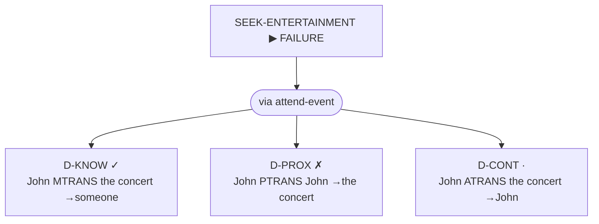

# CD-ATN Parser

A parser that turns an English sentence into a **Roger Schank Conceptual
Dependency (CD)** structure, built on an **Augmented Transition Network (ATN)**
with recursive sub-networks and an explicit push/pop stack.

```
"John gave Mary the book"
   │
   ▼  tokenize
[{:word "John" :cat :noun} {:word "gave" :cat :verb-give} …]
   │
   ▼  parse-all  (backtracking DFS over cd-atn-rules)
{:primitive :ATRANS :actor "John" :from "John" :to "Mary" :object "book"}
```

Source: [`development/src/atndev/core.clj`](development/src/atndev/core.clj) ·
Scripts/MOPs: [`development/src/atndev/scripts.clj`](development/src/atndev/scripts.clj) ·
Tests: [`development/test/atndev/`](development/test/atndev/) — run with
`clojure -M:dev:test`.

---

## 1. Conceptual Dependency in one paragraph

Schank's insight (late 1960s–70s): meaning should be represented **independently
of the words used to express it**. "John gave Mary a book", "Mary received a book
from John", and "John handed the book over" are three sentences with *one*
underlying meaning. CD encodes that meaning as a small, fixed set of **primitive
ACTs** plus role slots (actor, object, source, recipient). Two sentences that mean
the same thing normalize to the same CD structure — which is what lets a machine
*reason* about them (answer questions, draw inferences) rather than just match
strings.

### The 11 primitive ACTs

Every action verb in this parser maps to one of these primitives. The verb is the
trigger: seeing "gave" fires an `ATRANS` *expectation*, and the parser then goes
looking for the roles that ACT requires.

| Primitive | Meaning | Example verbs | Example → CD |
|-----------|---------|---------------|--------------|
| **ATRANS** | transfer of an abstract relationship (possession, ownership) | give, take, buy, sell | "John gave Mary the book" → `{:primitive :ATRANS :actor "John" :from "John" :to "Mary" :object "book"}` |
| **PTRANS** | transfer of physical location | go, run, move, drive | "John went to the store" → `{:primitive :PTRANS :actor "John" :object "John" :to "store"}` |
| **MTRANS** | transfer of mental information | tell, say, ask, read | "John told Mary a story" → `{:primitive :MTRANS :actor "John" :from "John" :to "Mary" :object "story"}` |
| **MBUILD** | build new information from old | decide, conclude, reason | "Mary decided" → `{:primitive :MBUILD :actor "Mary"}` |
| **PROPEL** | apply physical force | push, pull, kick, throw | "John pushed the cart" → `{:primitive :PROPEL :actor "John" :object "cart"}` |
| **MOVE** | move a body part | wave, nod, kick (a leg) | "Mary waved her hand" → `{:primitive :MOVE :actor "Mary" :object "hand"}` |
| **GRASP** | grip an object | grab, hold, clutch | "Mary grabbed the hammer" → `{:primitive :GRASP :actor "Mary" :object "hammer"}` |
| **INGEST** | take a substance into the body | eat, drink, swallow | "John ate the apple" → `{:primitive :INGEST :actor "John" :object "apple"}` |
| **EXPEL** | force a substance out of the body | spit, vomit, cry, sweat | "The baby spit up the milk" → `{:primitive :EXPEL :actor "baby" :object "milk"}` |
| **SPEAK** | produce a sound / vocalization | yell, sing, say, shout | "John yelled fire" → `{:primitive :SPEAK :actor "John" :object "fire"}` |
| **ATTEND** | direct a sense organ at a stimulus | listen, look, watch, see | "Mary listened to the music" → `{:primitive :ATTEND :actor "Mary" :to "music"}` |

**The power of a small set:** with only 11 ACTs, many surface verbs collapse onto
one frame, and inference rules can be written *once per primitive* instead of once
per verb. An `INGEST` always implies "the substance is now inside the actor"; an
`ATRANS` always implies "the recipient now has, and the source no longer has, the
object" — regardless of whether the verb was "gave", "handed", or "donated".

---

## 2. What an ATN is

An **Augmented Transition Network** is a finite-state machine extended with two
things that make it able to parse natural language rather than just regular
languages:

1. **Registers** — a mutable bag of named slots (here: the CD structure being
   built). Each arc can run an *action* that updates the registers. This is the
   "augmented" part.
2. **Recursion via push/pop** — an arc can *call* another sub-network (like a
   subroutine), parse a phrase with it, and return a result. This is what lifts an
   ATN from finite-state power up to (roughly) context-free / recursive power, and
   it needs a **stack**.

A network is a map of **nodes** to lists of **arcs**. Parsing walks node → node,
consuming words and firing arc actions, until it reaches an accept node with the
input exhausted.

### The three arc types

```clojure
;; :cat  — consume the current word if its category matches :val, run :action,
;;          move to :next.
{:type :cat :val :noun :next :got-actor
 :action (fn [registers word] (assoc registers :actor word))}

;; :push — call sub-network :net (by default starting at its :start with EMPTY
;;          registers, same words). Remember where to come back to (:next) and how
;;          to fold the sub-result in (:action) by saving a frame on the stack.
;;          Optional :start-node / :init let the call enter mid-network with seeded
;;          registers (used for infinitives — see §5).
{:type :push :net :S :next :end
 :action (fn [saved-registers result] (assoc saved-registers :to result))}

;; :pop  — leave the current sub-network. :action turns the sub-network's
;;          registers into the "result" handed back to the caller.
{:type :pop :action (fn [registers] registers)}
```

---

## 3. Parser state and the two core functions

### State

Every point in the search is one immutable map:

```clojure
{:network   :S          ; which (sub-)network we are in
 :node      :got-actor  ; which node within it
 :words     [{:word "gave" :cat :verb-give} …]  ; input still to consume
 :registers {:actor "John"}                     ; the CD built so far
 :stack     []}         ; push/pop return frames (the recursion stack)
```

### `transition-states` — expand one state into all its successors

```clojure
(defn transition-states [state rules]
  (let [{:keys [network node words registers stack]} state
        current-word (first words)
        arcs (get-in rules [network node])]
    (keep (fn [arc]
            (case (:type arc)
              :cat  (when (= (:cat current-word) (:val arc))
                      {:network network :node (:next arc) :words (rest words)
                       :registers ((:action arc) registers (:word current-word))
                       :stack stack})
              :push {:network (:net arc) :node (:start-node arc :start) :words words
                     :registers (if-let [init (:init arc)] (init registers) {})
                     :stack (conj stack {:return-net network
                                         :return-node (:next arc)
                                         :action (:action arc)
                                         :saved-registers registers})}
              :pop  (when (seq stack)
                      (let [{:keys [return-net return-node action saved-registers]} (last stack)
                            result ((:action arc) registers)]
                        {:network return-net :node return-node :words words
                         :registers (action saved-registers result)
                         :stack (pop stack)}))
              nil))
          arcs)))
```

The crucial detail is that it returns **all** valid next states (via `keep`), not
just the first. That is what lets the caller **backtrack**.

### `parse-all` — backtracking depth-first search

```clojure
(defn parse-all [words rules]
  (let [initial-state {:network :S :node :start :words words :registers {} :stack []}]
    (loop [agenda [initial-state]   ; a vector used as a stack of states to explore
           valid-parses []]
      (if (empty? agenda)
        valid-parses
        (let [current-state (peek agenda)
              rest-agenda   (pop agenda)]
          (if (and (empty? (:words current-state))
                   (= (:node current-state) :end)
                   (empty? (:stack current-state)))   ; ← success condition
            (recur rest-agenda (conj valid-parses (:registers current-state)))
            (let [next-branches (transition-states current-state rules)]
              (recur (into rest-agenda next-branches) valid-parses))))))))
```

`parse-cd` is the thin driver on top: `(first (parse-all (tokenize sentence)
cd-atn-rules))`.

#### The success condition — and why all three clauses matter

A state is a finished parse **only** when:

- `(empty? words)` — every input word was consumed (no leftovers), **and**
- `(= node :end)` — we are at an accept node, **and**
- `(empty? stack)` — we are back at the top level, not inside a sub-network call.

The third clause is subtle and essential once recursion is in play. A clause parsed
by a recursive `:push` into `:S` *also* ends at `:node :end`; if its words happen to
run out there, without the `(empty? stack)` check it would be mistaken for a
finished top-level parse and returned **before popping back** to fill the parent's
slot. Requiring an empty stack forces such a state to take its `:pop` arc instead.
(The earlier non-recursive `:CLAUSE` sub-network dodged this by naming its accept
node `:cl-end` rather than `:end` — a lucky accident that recursion exposed.)

---

## 4. The CD grammar (`cd-atn-rules`)

The grammar is a map of two networks: `:S` (the main sentence) and `:CLAUSE` (a
small embedded-clause helper). Instead of building a syntax tree, the arc actions
translate the verb **straight into a CD primitive** and then collect the roles that
primitive expects.

### Frame reuse: 11 primitives, 4 shapes

The key design economy — the 11 ACTs share only **four** grammatical shapes, so
adding a verb is usually one lexicon entry plus one arc:

| Shape | Node path | Primitives | Shape of the tail |
|-------|-----------|------------|-------------------|
| **Ditransitive** | `:got-actor → :got-action → :got-recipient → :end` | ATRANS, MTRANS | `<recipient> [det] <object>` |
| **Destination** | `:got-actor → :got-motion → :got-to → :end` | PTRANS, ATTEND | `to/at [det] <place/object>` |
| **Transitive** | `:got-actor → :got-force → :end` | PROPEL, INGEST, GRASP, MOVE, EXPEL, SPEAK | `[particle] [det] <object>` |
| **Intransitive** | `:got-actor → :end` | MBUILD | *(nothing)* |

### Node map

```
:S
 ├─ :start ──────── det (self-loop, skip "The") ─┐
 │                └ noun → :got-actor  (sets :actor)
 │
 ├─ :got-actor ─── verb-give   → :got-action   (ATRANS; :from = actor)
 │              ├─ verb-tell   → :got-action   (MTRANS; :from = actor)
 │              ├─ verb-go     → :got-motion   (PTRANS; :object = actor)
 │              ├─ verb-attend → :got-motion   (ATTEND)
 │              ├─ verb-perceive → :got-percept (ATTEND, direct clause — "saw")
 │              ├─ verb-push/ingest/grasp/move/expel/speak → :got-force  (transitive)
 │              └─ verb-mbuild → :end          (MBUILD, intransitive)
 │
 ├─ :got-action ── det → :got-recip-det ─┐      (ditransitive recipient)
 │              └ noun → :got-recipient  │ (:to)
 │   :got-recip-det ─ noun → :got-recipient (:to)
 │   :got-recipient ─ det → :got-det ─┐
 │                  └ noun → :end     │ (:object)
 │   :got-det ─────── noun → :end     │ (:object)
 │
 ├─ :got-motion ── prep → :got-to
 │   :got-to ────── det → :got-dest-det ─┐    (destination)
 │              ├─ noun → :end (:to)      │
 │              ├─ PUSH :S → :end         │    (recursive clause complement)
 │              └─ PUSH :CLAUSE → :end    │    (bare intransitive complement)
 │   :got-dest-det ─ noun → :end (:to)
 │
 ├─ :got-percept ── det → :got-percept-det ─┐  (perception, no preposition)
 │               ├─ noun → :end (:to)        │
 │               └─ PUSH :S → :end           │  (recursive clause complement)
 │   :got-percept-det ─ noun → :end (:to)
 │
 ├─ :got-force ──── particle (self-loop, skip "up") ─┐  (transitive object)
 │              ├─ det → :got-force-det              │
 │              └─ noun → :end (:object)             │
 │   :got-force-det ─ noun → :end (:object)
 │
 └─ :end ─────────── POP  (returns the built CD to a caller, or accepts at top level)

:CLAUSE  (a minimal "subject verb" clause; used only for bare intransitives)
 ├─ :start ──────── det → :cl-det ─┐
 │              └ noun → :cl-subj  │ (:actor)
 ├─ :cl-det ─────── noun → :cl-subj (:actor)
 ├─ :cl-subj ────── verb-intrans → :cl-end (:action)
 └─ :cl-end ─────── POP  (returns {:actor … :action …})
```

### General features layered on the frames

Several small self-loops / determiner detours make the grammar cover ordinary
English without multiplying the primitives:

- **Determiner-led subject** — a `:det` self-loop at `:start` skips a leading
  "The" ("**The** baby spit up the milk").
- **Verb particle** — a `:particle` self-loop at `:got-force` skips "up"/"out"
  ("spit **up** the milk").
- **Optional determiners** everywhere a noun is expected — recipient
  (`:got-recip-det`), object (`:got-det`, `:got-force-det`), destination
  (`:got-dest-det`), perception object (`:got-percept-det`).

Because unknown words default to `:noun` in the tokenizer, the parser never
*rejects* a word for being unknown; a parse fails only when it cannot consume all
the input (reaches `:end` with words left over, or has no matching arc).

**Extending the lexicon.** The word→category map lives in its own namespace,
[`lexicon.clj`](development/src/atndev/lexicon.clj), as `word-groups` (category →
word-list) flattened by `from-groups` into the flat `lexicon` the tokenizer reads.
Grow it three ways: edit the vectors in `word-groups`; call `add-words` /
`merge-groups` from code; or drop a `{:verb-give ["gifted"] …}` EDN file and layer it
in with `load-groups` (an `atndev/lexicon-extra.edn` on the classpath is merged
automatically). Category keys must match the grammar's arcs (`:verb-give` → ATRANS,
…); adding *words* to an existing category is always safe, and a test enforces that
no word lands in two categories (which would make tokenization nondeterministic).

---

## 5. Recursive sub-networks and the stack

This is the heart of the parser. CD is inherently recursive: the object of a
perception or mental ACT is not a thing, it is **another conceptualization**.
"Mary saw the dog eat the bone" is not `ATTEND` on the object "dog" — it is
`ATTEND` whose `:to` is the *whole event* {the dog eats the bone}.

The parser models this by having an arc **push into `:S` again** — the very same
network parses both the matrix sentence and its embedded clause.

### What push and pop do to the stack

**Push** (`transition-states`, `:push` branch): start the named sub-network at
`:start` with **fresh, empty registers**, keep the same remaining words, and record
a **return frame** on the stack:

```clojure
{:return-net    network            ; where to resume
 :return-node   (:next arc)         ; the node to resume at
 :action        (:action arc)       ; how to fold the child's result into the parent
 :saved-registers registers}        ; the parent's CD, set aside until we return
```

**Pop** (`:pop` branch): the sub-network is done. Compute
`result = ((:action pop-arc) registers)` (the child's finished CD), take the top
return frame, and rebuild the parent state:

```clojure
{:network   return-net
 :node      return-node
 :words     words                              ; whatever the child left unconsumed
 :registers (action saved-registers result)    ; parent CD + child grafted into :to
 :stack     (pop stack)}                        ; frame removed
```

So the parent's registers are **preserved on the stack** while the child parses
with a clean slate, then the push arc's `:action` — e.g.
`(fn [saved result] (assoc saved :to result))` — grafts the child's CD into the
parent's `:to` slot. Stack **depth = current nesting level**.

### Worked trace: `"Mary saw the dog eat the bone"`

Produced by `trace-parse` (see §6). `depth` is `(count stack)`.

```
 1  visit :S/:start        words=["Mary" "saw" "the" "dog" "eat" "the" "bone"]  regs={}                              depth=0
 2  visit :S/:got-actor    words=["saw" "the" "dog" "eat" "the" "bone"]         regs={:actor "Mary"}                 depth=0
 3  visit :S/:got-percept  words=["the" "dog" "eat" "the" "bone"]  regs={:actor "Mary" :primitive :ATTEND}  depth=0  → 2 branches
 4  visit :S/:start        words=["the" "dog" "eat" "the" "bone"]              regs={}                    depth=1   ← PUSHED into :S
 5  visit :S/:start        words=["dog" "eat" "the" "bone"]                    regs={}                    depth=1
 6  visit :S/:got-actor    words=["eat" "the" "bone"]                         regs={:actor "dog"}        depth=1
 7  visit :S/:got-force    words=["the" "bone"]         regs={:actor "dog" :primitive :INGEST}           depth=1
 8  visit :S/:got-force-det words=["bone"]              regs={:actor "dog" :primitive :INGEST}           depth=1
 9  visit :S/:end          words=[]  regs={:actor "dog" :primitive :INGEST :object "bone"}  depth=1  ← NOT done (stack≠∅) → must POP
10  DONE  :S/:end          regs={:actor "Mary" :primitive :ATTEND
                                 :to {:actor "dog" :primitive :INGEST :object "bone"}}  depth=0  ✓  ← POPPED + grafted
```

Read the two turning points:

- **Step 3 → 4 (push):** at `:got-percept` two arcs match — a plain-noun arc and a
  `:push :S`. The push branch enters `:S` afresh (`regs={}`, `depth=1`) while
  `{:actor "Mary" :primitive :ATTEND}` waits on the stack.
- **Step 9 (why the empty-stack check matters):** the child reaches `:S/:end` with
  no words left, but `depth=1`. Without the `(empty? stack)` clause this would be
  wrongly accepted as the answer (`{… INGEST …}`). Instead it is not a success, so
  the `:pop` arc fires.
- **Step 10 (pop + graft):** popping applies the push arc's action
  `(assoc saved :to result)` — `saved` = Mary's ATTEND frame, `result` = the dog's
  INGEST frame — producing the nested CD, back at `depth=0`, words empty → accepted.

The other backtracking branch (the plain-noun arc at step 3) tries `:to "dog"` and
dies with "eat the bone" left over — a dead end the agenda discards.

### Arbitrary depth

Because the complement of a perception verb is just `:S` again, nesting is
unbounded — limited only by the input, not the grammar. `depth` simply climbs one
per level and unwinds:

```clojure
;; "Mary saw the dog see the cat see the bird eat the worm"   (depth reaches 3)
{:primitive :ATTEND :actor "Mary"
 :to {:primitive :ATTEND :actor "dog"
      :to {:primitive :ATTEND :actor "cat"
           :to {:primitive :INGEST :actor "bird" :object "worm"}}}}
```

Any complete inner frame nests, not just `INGEST`:

```clojure
;; "Mary saw the dog go to the store"
{:primitive :ATTEND :actor "Mary"
 :to {:primitive :PTRANS :actor "dog" :object "dog" :to "store"}}

;; "Mary saw the dog give the cat a bone"
{:primitive :ATTEND :actor "Mary"
 :to {:primitive :ATRANS :actor "dog" :from "dog" :to "cat" :object "bone"}}
```

### Mental-ACT complements: `MTRANS` / `MBUILD` and seeded push

Perception (`ATTEND`) is not the only ACT whose object is a conceptualization. The
two *mental* primitives take a whole thought as their content:

- **`MTRANS`** transfers information — "John **said** [Mary left]". The message is
  an event, so the `:got-action` node (shared with the ditransitive branch) gets a
  `:push :S` arc that stores the parsed clause in `:object`:

  ```clojure
  ;; "John said Mary left"
  {:primitive :MTRANS :actor "John" :from "John"
   :object {:primitive :PTRANS :actor "Mary" :object "Mary"}}
  ```

  Backtracking keeps this unambiguous: a real ditransitive tail like "Mary a story"
  is *not* a clause, so only one branch survives (see the `trace-parse` output for
  "John said Mary left").

- **`MBUILD`** constructs a thought/plan — "John **decided** [to leave]". This one
  needs the **seeded push**, because an infinitive has *no surface subject*: "to
  leave" is understood to be *John* leaving. The `:got-thought` node consumes "to"
  and then pushes into `:S` **starting at `:got-actor`** (past the subject node)
  with the actor `:init`-ialized from the parent:

  ```clojure
  {:type :push :net :S :start-node :got-actor
   :init (fn [r] {:actor (:actor r)})     ; the decider becomes the embedded actor
   :next :end
   :action (fn [saved result] (assoc saved :object result))}
  ```

  ```clojure
  ;; "John decided to leave"                 ;; "John decided to eat the cake"
  {:primitive :MBUILD :actor "John"          {:primitive :MBUILD :actor "John"
   :object {:primitive :PTRANS               :object {:primitive :INGEST
            :actor "John" :object "John"}}             :actor "John" :object "cake"}}
  ```

Both keep their non-complement forms via a second arc: `MBUILD` still parses the
intransitive "Mary decided" (`verb-mbuild → :end`), and `MTRANS` still parses the
ditransitive "John told Mary a story". A small `:verb-depart` category ("left",
"leave") supplies the intransitive-PTRANS clause "Mary left" needs to complete.

### `:S` recursion vs. the `:CLAUSE` helper

Two complement styles coexist, disambiguated for free by backtracking (a verb
belongs to exactly one lexical category, so at most one branch survives):

- **`:push :S`** — a full clause that has its **own primitive**
  ("the dog **eat** the bone" → nested `INGEST`).
- **`:push :CLAUSE`** — a *bare intransitive* whose verb (e.g. "snore") is tagged
  `:verb-intrans` and has no arc in `:S`; the tiny `:CLAUSE` net catches it,
  yielding `{:actor "dog" :action "snore"}`. ("Mary listened to the dog snore".)

---

## 6. Tracing every layer (`trace-*`)

Each layer of the system has a `trace-*` companion that prints its process
step-by-step. They all follow the same contract: **the traced function returns
exactly what its plain counterpart returns** (verified by tests), so a `trace-*`
call is a drop-in diagnostic — swap it in, read the trace, swap it back out.

| Tracer | Layer | Plain fn | What it shows |
|--------|-------|----------|---------------|
| `core/trace-parse`          | sentence → CD | `parse-cd` / `parse-all` | the ATN agenda: node visited, words left, registers, stack depth, branch fan-out |
| `scripts/trace-understand`  | script + MOPs (§7) | `understand` | parse → bind roles → MOP splice → timeline (stated/inferred) |
| `scripts/trace-causal-chain`| story → causal chain (§8) | `causal-chain` | the CS5 goal link, then each scene's bridge state + CS1/CS2 links |
| `causal/trace-consequences` `causal/trace-why` | causal inference (§8) | `consequences` / `why` | the frontier walk: each node, its causal fan-out, where links lead |
| `plans/trace-plan`          | plan → causal chain (§9) | `plan->causal` | goal → chosen realization → step acts → the IR bridge (CS4/CS5) + CS1/CS2 thread |
| `goal-monitor/trace-monitor`| goal monitoring (§10) | `watch` | per event: goal recognized, subgoal fate changes, predictions, fate history on goal-end |

### 6.1 `core/trace-parse` — watching the parse agenda

Re-runs the exact `parse-all` loop, one line per agenda step: which
`(network/node)` is popped, the words left, the registers so far, the stack
`depth`, and how many next branches the state fans out into.

```clojure
(require '[atndev.core :as cd])

(cd/trace-parse "John gave Mary the book")        ; a clean linear parse
(cd/trace-parse "Mary saw the dog eat the bone")  ; watch depth 0→1 (a recursive :push)
```
```
  1  visit :S/:start      words=["John" "gave" "Mary" "the" "book"]  regs={}  depth=0  → 1 branch(es)
  2  visit :S/:got-actor  words=["gave" "Mary" "the" "book"]  regs={:actor "John"} …
  …
  6  DONE  :S/:end  regs={:actor "John" :primitive :ATRANS …}  ✓ PARSE COMPLETE
```

- `→ N branch(es)` is the fan-out from `transition-states`; `> 1` means the agenda
  now holds alternatives (backtracking), `0` is a dead end.
- `depth` > 0 means we are inside a `:push`ed sub-network (see §5).

### 6.2 `scripts/trace-understand` — script + MOP instantiation

Shows the four-step instantiate pipeline (§7): each parsed frame, which anchor
scene it matched and the role bindings it taught, any MOPs spliced in, and the
resulting timeline.

```clojure
(require '[atndev.scripts :as s])

(s/trace-understand ["John went to the restaurant" "John ate the lobster"])
;; other script — same machinery, pass it explicitly:
(s/trace-understand s/store-script ["Mary went to the store" "Mary grabbed the milk"])
```
```
TRACE understand :$RESTAURANT
1. Parse sentences -> CD frames:
     "John went to the restaurant"  -> {:actor "John" :primitive :PTRANS :object "John" :to "restaurant"}
     "John ate the lobster"         -> {:actor "John" :primitive :INGEST :object "lobster"}
2. Bind roles (match stated frames to anchor scenes):
     {…PTRANS…} ⇒ :entering learns {:customer "John" :restaurant "restaurant"}
     {…INGEST…} ⇒ :eating   learns {:customer "John" :food "lobster"}
   bindings => {:customer "John" :restaurant "restaurant" :food "lobster"}
3. MOPs spliced: $PAY (abstract roles remapped to script roles)
4. Timeline (scene [status] cd):
     entering    [stated  ]       {:primitive :PTRANS …}
     ordering    [inferred]       {:primitive :MTRANS …}
     …
     requesting  [inferred] $PAY  {:primitive :MTRANS …}
     tendering   [inferred] $PAY  {:primitive :ATRANS …}
     leaving     [inferred]       {:primitive :PTRANS …}
```

### 6.3 `scripts/trace-causal-chain` — compiling a story into CS-links

Shows how the timeline becomes a causal chain (§8): the `:goal` → CS5 link, then
for each adjacent scene pair the bridging state and its CS1/CS2 links.

```clojure
(require '[atndev.scripts :as s])

(let [story (s/understand ["John went to the restaurant" "John ate the lobster"])]
  (s/trace-causal-chain story))
```
```
TRACE causal-chain :$RESTAURANT  goal = :hungry  customer = "John"
  CS5 John{hungry}             --reason--> John PTRANS John →restaurant
  entering: bridge state: John{location=restaurant}
    CS1 John PTRANS John →restaurant --result--> John{location=restaurant}
    CS2 John{location=restaurant} --enable--> John MTRANS an order →the waiter
  …
=> 13 validated links; valid-chain? = true
```

### 6.4 `causal/trace-consequences` / `causal/trace-why` — walking the graph

The direct analog of the parse agenda, for causal inference (§8): each step prints
the node reached, how many causal links lead out of it (fan-out), and their CS
types + targets. `trace-why` walks backward (an explanation), `trace-consequences`
forward (effects).

```clojure
(require '[atndev.scripts :as s] '[atndev.causal :as c])

(let [story (s/understand ["John went to the restaurant" "John ate the lobster"])
      chain (s/causal-chain story)]
  (c/trace-why chain (:cd (last (:timeline story))))    ; why did John leave?
  (c/trace-consequences chain (:from (first chain))))   ; what did John{hungry} lead to?
```
```
TRACE backward from John PTRANS John
  1  John PTRANS John                 1 link(s) → CS2:the money{possession=restaurant}
  …
 13  John PTRANS John →restaurant     1 link(s) → CS5:John{hungry}
 14  John{hungry}                     0 link(s)
DONE — 13 causal link(s)
```

> **Maintenance note:** each `trace-*` keeps its **own copy** of the loop it mirrors
> (`trace-parse` ↔ `parse-all`, `trace-consequences`/`trace-why` ↔
> `consequences`/`causes`). If you change a termination or ordering rule — e.g.
> `parse-all`'s `(empty? stack)` success clause — update the matching tracer too.
> The "trace returns the same value as the plain fn" tests will catch drift.

---

## 7. Above the sentence: Scripts and MOPs

CD primitives are the *micro* level — they capture the meaning of a single clause.
But understanding a *story* means knowing what normally happens even when the text
doesn't say it. "John went to a restaurant. He ate lobster." — a person infers a
waiter took an order, the food was served, John paid and left. None of that is
stated; all of it is understood. `atndev.scripts`
([`scripts.clj`](development/src/atndev/scripts.clj)) adds Schank's higher-level
memory structures on top of the CD frames the parser emits, to do exactly this.

### 7.1 Scripts — canned event sequences

A **script** is a stereotyped sequence of expected CD events for a situation, with
**roles** (customer, waiter) and **props** (restaurant, food, check). It is plain
data:

```clojure
(def restaurant-script
  {:name  :$RESTAURANT
   :roles #{:customer :waiter :cook}
   :props #{:restaurant :food :order}
   :defaults {:waiter "the waiter" :cook "the cook"
              :restaurant "the restaurant" :food "the meal" :order "an order"}
   :events
   [{:scene :entering
     :cd    {:primitive :PTRANS :actor :customer :object :customer :to :restaurant}
     :match (fn [f] (and (= :PTRANS (:primitive f)) (= (:actor f) (:object f)) (:to f)))
     :bind  (fn [f] {:customer (:actor f) :restaurant (:to f)})}
    {:scene :ordering
     :cd    {:primitive :MTRANS :actor :customer :object :order :to :waiter}}
    {:scene :serving
     :cd    {:primitive :PTRANS :actor :waiter :object :food :to :customer}}
    {:scene :eating
     :cd    {:primitive :INGEST :actor :customer :object :food}
     :match (fn [f] (= :INGEST (:primitive f)))
     :bind  (fn [f] {:customer (:actor f) :food (:object f)})}
    {:mop :$PAY :roles {:payer :customer :payee :restaurant}}   ; ← MOP reference (§7.2)
    {:scene :leaving
     :cd    {:primitive :PTRANS :actor :customer :object :customer :from :restaurant}}]})
```

Three kinds of thing live in `:events`:

- **A `:cd` template** whose slots are **role/prop keywords** (`:customer`,
  `:food`) instead of literals. `:primitive` stays a literal — it is not a role.
- **Anchor events** additionally carry `:match` (a predicate on an observed CD
  frame) and `:bind` (turns a matching frame into role bindings). These are the
  scenes the parser can actually *observe* in the text. Non-anchor scenes
  (`:ordering`, `:serving`, `:leaving`) have no `:match` and are therefore always
  **inferred**.
- **A MOP reference** `{:mop … :roles …}` — spliced in at §7.2.

### 7.2 MOPs — shared, parameterized sub-sequences

Paying is not restaurant-specific — you pay in stores, taxis, hotels. Duplicating a
"paying" scene in every script is exactly the repetition CD teaches us to avoid. A
**MOP (Memory Organization Packet)** factors such a sub-sequence out **once**, with
its own **abstract roles**, and each script points at it with a role mapping:

```clojure
(def pay-mop
  {:name  :$PAY
   :roles #{:payer :payee}          ; abstract — not "customer", not "shopper"
   :props #{:bill :money}
   :defaults {:bill "the bill" :money "the money"}
   :events
   [{:scene :requesting :cd {:primitive :MTRANS :actor :payer :object :bill :to :payee}}
    {:scene :tendering  :cd {:primitive :ATRANS :actor :payer :object :money
                             :from :payer :to :payee}}]})

(def mop-registry {:$PAY pay-mop})
```

The restaurant references it with `{:mop :$PAY :roles {:payer :customer :payee
:restaurant}}`. A second script reuses the *same* MOP with a *different* mapping —
this is the whole point of "shared":

```clojure
(def store-script
  {:name :$STORE :roles #{:customer :clerk} :props #{:store :goods}
   :defaults {:clerk "the clerk" :store "the store" :goods "the goods"}
   :events
   [{:scene :entering  :cd {:primitive :PTRANS :actor :customer :object :customer :to :store}
     :match … :bind (fn [f] {:customer (:actor f) :store (:to f)})}
    {:scene :selecting :cd {:primitive :GRASP :actor :customer :object :goods}
     :match (fn [f] (= :GRASP (:primitive f))) :bind (fn [f] {:customer (:actor f) :goods (:object f)})}
    {:mop :$PAY :roles {:payer :customer :payee :store}}       ; ← same MOP, remapped
    {:scene :leaving   :cd {:primitive :PTRANS :actor :customer :object :customer :from :store}}]})
```

Change how paying works in `pay-mop` once and **every** script that references it
updates. This mirrors the parser's own lesson (frame reuse, recursive `:S`) one
level up: don't repeat structure — factor it and parameterize it.

### 7.3 The engine

Four small functions turn "a script + the sentences a text stated" into a fully
understood timeline.

**`resolve-events`** flattens a script's `:events`, **splicing** each `{:mop …}`
reference into the MOP's scenes with its abstract roles **remapped** to the script's
roles (`:payer → :customer`, `:payee → :restaurant`). It also accumulates the MOP's
props/defaults so later substitution knows about `:bill`/`:money`. Spliced scenes
are tagged with `:mop` for provenance.

**`bind-roles`** scans the observed CD frames (from `parse-cd`); for each frame that
satisfies an anchor event's `:match`, it merges in that event's `:bind` result. From
"John went to the restaurant" + "John ate the lobster" it learns
`{:customer "John" :restaurant "restaurant" :food "lobster"}`.

**`fill`** substitutes role/prop keywords in a `:cd` template with the learned
bindings, falling back to `:defaults` (so the unstated `:waiter` becomes
`"the waiter"`). Literal keywords like the `:primitive` value pass through
untouched.

**`instantiate`** ties it together: resolve → bind → for every (possibly
MOP-spliced) event, `fill` its template and tag it `:stated` (an observed frame
matched this anchor) or `:inferred`. `understand` is the driver:
`(understand ["…" "…"])` parses the sentences and instantiates `$RESTAURANT` by
default, or `(understand store-script ["…"])` for another script.

### 7.4 Worked example

```clojure
(understand ["John went to the restaurant" "John ate the lobster"])
```

yields (via `explain`):

```
Script :$RESTAURANT  bindings={:customer "John", :restaurant "restaurant", :food "lobster"}
Timeline:
  entering    [stated  ]        {:primitive :PTRANS :actor "John" :object "John" :to "restaurant"}
  ordering    [inferred]        {:primitive :MTRANS :actor "John" :object "an order" :to "the waiter"}
  serving     [inferred]        {:primitive :PTRANS :actor "the waiter" :object "lobster" :to "John"}
  eating      [stated  ]        {:primitive :INGEST :actor "John" :object "lobster"}
  requesting  [inferred] $PAY   {:primitive :MTRANS :actor "John" :object "the bill" :to "restaurant"}
  tendering   [inferred] $PAY   {:primitive :ATRANS :actor "John" :object "the money" :from "John" :to "restaurant"}
  leaving     [inferred]        {:primitive :PTRANS :actor "John" :object "John" :from "restaurant"}
```

Two stated sentences become a **seven-scene** understood episode. Note the `$PAY`
MOP scenes (`requesting`, `tendering`) spliced in with `:payer`/`:payee` resolved to
`"John"`/`"restaurant"`, and `serving` correctly inferring the waiter served the
**actual** bound food ("lobster"), not a placeholder.

### 7.5 Inference & Q&A — the payoff

Because the whole episode is reconstructed, the system answers questions the text
never contained:

```clojure
(def story (understand ["John went to the restaurant" "John ate the lobster"]))

(happened? story :serving)   ; => true   (never stated — inferred by the script)
(paid?     story)            ; => true   (the $PAY MOP ran)
(:food (:bindings story))    ; => "lobster"

(inferences story)
;; => ("John went to restaurant  (PTRANS: entering)"
;;     "lobster is now inside John, no longer on the plate  (INGEST)"
;;     "John was hungry before eating  (INGEST precondition)"
;;     "John paid the bill to restaurant  ($PAY MOP: MTRANS + ATRANS)"
;;     "John is no longer at restaurant  (PTRANS: leaving)")
```

`inferences` derives entailments both from the **primitives** (an `INGEST` implies
the food is now inside the actor and that the actor was hungry) and from the
**script/MOP** (the episode implies paying and leaving happened).

### 7.6 Graceful degradation

An empty story still instantiates the full frame using role defaults — the script
*is* the prior knowledge:

```clojure
(understand [])   ; => 7 scenes, all :inferred, bindings {}, using "the customer"/"the meal"/…
```

### 7.7 Where this points: MOPs → TOPs

The current layer implements Scripts and one MOP. Schank's later work continued up
the abstraction ladder, and the same "factor and parameterize" move generalizes:

- **More scripts + a selector.** Today `$RESTAURANT` is the default and `$STORE` is
  passed explicitly. A selector would pick the script whose *anchor events* match
  the incoming CD frames (e.g. an opening `GRASP` of goods ⇒ `$STORE`).
- **More shared MOPs.** `$ENTER`/`$LEAVE` (the PTRANS in/out that bookend nearly
  every script) and `$ORDER` are natural next extractions, each referenced by
  several scripts — the memory isn't one script per situation, it's a web of shared
  packets.
- **Deviation handling.** When a stated frame *contradicts* the script (a customer
  leaves without a `$PAY`), flag the anomaly instead of silently inferring payment.
  That is what made scripts interesting for *story understanding* rather than mere
  template-filling.
- **TOPs (Thematic Organization Packets).** The most abstract layer — cross-domain
  themes like "the favor betrayed" or "mutual goal pursuit" that let a system relate
  a restaurant story to a business story because they share a *thematic* shape, not
  any surface events.

See [`scripts.clj`](development/src/atndev/scripts.clj) and
[`scripts_test.clj`](development/test/atndev/scripts_test.clj) for the full working
`$RESTAURANT` + `$PAY` + `$STORE` implementation and tests.

---

## 8. Causal links (CS1–CS5) — inference chains

Where a CD frame captures the meaning of one clause, **causal links** connect
frames into the chains that let a reader infer *why* things happen — the "syntax of
causality" from *Scripts, Plans, Goals, and Understanding* (Schank & Abelson 1977).
Implemented in [`causal.clj`](development/src/atndev/causal.clj).

### Three node kinds

Causality connects three kinds of thing, discriminated by `entity-kind`:

- **ACT** — a CD conceptualization (has a `:primitive`), straight from `parse-cd`.
- **STATE** — a world condition: `(state object state-kw value)` →
  `{:kind :state :object "door" :state :open :value true}`.
- **MENTAL STATE** — a belief/desire/emotion: `(mental-state actor ms-kw)` →
  `{:kind :mental-state :actor "John" :state :hungry}`.

### The five link types

Each link type is **constrained** to specific node kinds — and that typing is what
makes causal inference *sound*, not mere bookkeeping:

| | Link | Antecedent → Consequent | Meaning |
|---|------|-------------------------|---------|
| **CS1** | `:result`   | ACT → STATE            | actions cause state changes |
| **CS2** | `:enable`   | STATE → ACT            | states enable actions |
| **CS3** | `:disable`  | STATE → ACT            | states disable actions |
| **CS4** | `:initiate` | STATE *or* ACT → MENTAL STATE | the world initiates thoughts |
| **CS5** | `:reason`   | MENTAL STATE → ACT     | thoughts are reasons for actions |

`causal-link` (and the shorthands `result`/`enable`/`disable`/`initiate`/`reason`)
**validate on construction** — an ill-typed link throws:

```clojure
(c/reason (c/state "John" :location "store") eat)
;; ExceptionInfo: CS5 (reason) antecedent must be #{:mental-state}, got :state
```

Because CS5 can *only* go MENTAL→ACT and CS1 *only* ACT→STATE, the canonical loop
**CS5 → CS1 → CS2** (a want drives an act, which changes the world, which enables
the next act) is guaranteed well-formed, and traversal can trust what it walks.

### CS1 made generative

`results` maps a parsed act's primitive to its canonical state changes, so the
parser feeds the causal layer automatically:

```clojure
(c/results (cd/parse-cd "John gave Mary the book"))
;; => [{:kind :state :object "book" :state :possession      :value "Mary"}
;;     {:kind :state :object "book" :state :possession-lost :value "John"}]
```

(PTRANS → location; INGEST → inside-actor + sated; GRASP → possession; …)
`result-links` wraps these as validated CS1 links.

### Inference by traversal

A **chain** is a vector of links. Two closures answer the questions CD exists to
answer:

```clojure
(c/why chain buy-dessert)        ; backward, antecedent-first — the explanation
;;   John ATTEND →dessert   --CS4 initiate--> John{wants-dessert}
;;   John{wants-dessert}    --CS5 reason  --> John ATRANS money →waiter

(c/consequences chain hungry)    ; forward transitive closure — what it leads to
;;   John{hungry}                 --CS5 reason  --> John PTRANS →restaurant
;;   John PTRANS →restaurant      --CS1 result  --> John{location=restaurant}
;;   John{location=restaurant}    --CS2 enable  --> John INGEST food
;;   John INGEST food             --CS1 result  --> food{location=inside John}
```

`explain` renders any chain with each hop's CS number, link type, and gloss;
`valid-chain?` checks a whole chain's typing. See
[`causal_test.clj`](development/test/atndev/causal_test.clj) for the worked
"John was hungry → … → bought dessert" chain that exercises all five types
(including a CS3 `disable`: `restaurant{closed}` disables `INGEST`).

### Compiling a script into a causal chain

The script layer (§7) and the causal layer meet in `scripts/causal-chain`, which
turns an instantiated story into a **validated** chain automatically: the script's
`:goal` mental state (e.g. `$RESTAURANT`'s `:hungry`) becomes the **CS5** reason for
the opening act, and every adjacent scene is threaded **CS1 → CS2** through a
bridging state derived from the act's primitive (via `causal/results`).

```clojure
(def story (s/understand ["John went to the restaurant" "John ate the lobster"]))
(def chain (s/causal-chain story))          ; 13 validated links, CS5 then CS1/CS2…

(causal/explain chain)
;;   John{hungry}                 --CS5 reason  --> John PTRANS →restaurant
;;   John PTRANS →restaurant      --CS1 result  --> John{location=restaurant}
;;   John{location=restaurant}    --CS2 enable  --> John MTRANS an order →the waiter
;;   … MTRANS --CS1--> waiter{knows=order} --CS2--> serving --CS1--> … --CS2--> eating …
;;   … --CS2 enable--> John ATRANS the money →restaurant --CS1--> … --CS2--> leaving

(causal/why chain (:cd (last (:timeline story))))   ; why did John leave? → back to :hungry
```

This is the string `inferences` upgraded to a **typed, traversable causal graph**:
the same `$STORE` script (with `:goal :wants-goods`) compiles the same way, and
`causal/why` / `causal/consequences` reason over the result. (The success chain uses
CS5/CS1/CS2; CS3 `disable` and CS4 `initiate` express blocked paths and newly
spawned wants — natural extensions to script deviations, per §7.7.)

---

## 9. Plans and Goals — bridging the IR gap

Scripts (§7) handle *stereotyped* situations and causal chains (§8) connect events
by result/enable. But much of a story is neither scripted nor a direct physical
consequence: *why* did seeing a concert ad lead to phoning a friend? No script
covers it, and one event does not physically *cause* the other. What connects them
is that the actor **has a goal** and **forms a plan**. That reasoning is the missing
link, and it is what the plans layer ([`plans.clj`](development/src/atndev/plans.clj))
supplies.

### 9.1 The IR gap — in detail

Recall the causal link types (§8). Two of them are about the mind:

- **CS4 `:initiate`** — a STATE or ACT initiates a MENTAL STATE (the world makes you
  *think* something).
- **CS5 `:reason`** — a MENTAL STATE is the reason for an ACT (a thought makes you
  *do* something).

Put back-to-back they form the **IR unit** (Initiate → Reason):

```
   <event>  --CS4 initiate-->  <MBUILD>  --CS5 reason-->  <action>
```

An event triggers a piece of mental building (an **MBUILD**, the CD primitive for
constructing new thought), and that MBUILD is in turn the reason for the next
action. Schank & Abelson's key claim: **what gets MBUILDed is a plan.** The mental
state sitting in the middle of an IR unit is not a mood or a bare belief — it is the
actor's *reasoning about how to get what they want*.

So the "IR gap" is the hole in a causal chain that neither a script nor plain
result/enable expansion can fill: the step from an event to an action that only
makes sense *given a goal*. A plan fills exactly that hole. Concretely, `plans`
represents the middle MBUILD as a mental-state node whose `:plan` key **is** the
plan, wires the event to it with CS4, and wires it to the first chosen action with
CS5 — after which each action drives its own ordinary CS1/CS2 chain:

```
 event --CS4--> MBUILD{plan} --CS5--> act₁ --CS1--> state --CS2--> act₂ --CS1--> …
```

That is why plans sit *above* both scripts and causal chains: they generate the very
IR links that let a reader infer the connective tissue a text leaves implicit.

### 9.2 Goals

A **goal** is what an actor wants. Schank & Abelson classify goals; the ones modelled
here (`goal-library`, with `class`):

| Class | Meaning | Example goal |
|-------|---------|--------------|
| `:S`  | Satisfaction — a recurring biological need | `:SATISFY-HUNGER` |
| `:E`  | Enjoyment | `:SEEK-ENTERTAINMENT` |
| `:A`  | Achievement — acquire something lasting | `:ACQUIRE-OBJECT` |
| `:P`  | Preservation — protect a state you have | `:STAY-HEALTHY` |
| `:D`  | **Delta** — a subgoal to *change one specific state* (see §9.3) | `:D-PROX` |

Each goal lists its **realizations** — the ways it can be pursued. A realization may
be a **script** (`{:script :$THEATRE}`), a **named plan** (`{:named-plan …}`), a
**delta goal** (`{:d-goal …}`), or a **planbox** (`{:planbox …}`). Your example —
*SEEK ENTERTAINMENT has $THEATRE, $BASEBALL-GAME, $CONCERT among its realizations* —
is encoded directly:

```clojure
(realizations :SEEK-ENTERTAINMENT)
;; => [{:named-plan :attend-event}
;;     {:script :$THEATRE} {:script :$BASEBALL-GAME} {:script :$CONCERT}]
```

### 9.3 D-Goals (delta goals)

A **D-goal** is a goal to *change one particular state of the world* — the operational
building block of every plan. Where an S/E/A/P goal says *what* you want, a D-goal
says *which state must flip* to get a step closer, and it **organizes the standard
methods for flipping it**. The five modelled here (`delta-goals`):

| D-goal | Changes the state… |
|--------|--------------------|
| `:D-PROX`     | proximity — be *near* a place or object |
| `:D-CONT`     | control — *have/possess* an object |
| `:D-KNOW`     | knowledge — *know* a piece of information |
| `:D-SOC-CONT` | social control — get *another agent to want* to do something |
| `:D-AGENCY`   | agency — get an agent to *act on your behalf* |

The point of a D-goal is indirection: many different surface situations reduce to
"I need to be near X" (`D-PROX`) or "I need to possess X" (`D-CONT`), so the planner
reasons once about *how to achieve proximity/possession* and reuses it everywhere —
exactly the factoring move seen in frame reuse (§4) and MOPs (§7). A D-goal's
realizations are its **planboxes**.

### 9.4 Planboxes

A **planbox** is a named, reusable *method* for achieving a D-goal — the concrete
option a planner chooses among. `D-CONT` (get an object), for instance, offers
`:buy`, `:ask`, `:bargain`, `:take`; `D-PROX` offers `:walk`, `:drive`, `:take-bus`;
`D-KNOW` offers `:ask`, `:read`, `:observe`. The planbox list is ordered by the
actor's default preference (the first is chosen unless you name another with `:via`).

The crucial job of a planbox is to **bottom out in a concrete CD act**, so the plan
re-enters the causal machinery. `planbox-acts` maps each planbox to the primitive it
performs:

| Planbox | CD act |
|---------|--------|
| `:walk` / `:drive` / `:take-bus` | `PTRANS` (self-motion to the object) |
| `:ask` | `MTRANS` (request information) |
| `:read` / `:observe` | `MTRANS` / `ATTEND` (take in information) |
| `:buy` / `:bargain` | `ATRANS` (transfer possession) |
| `:take` | `GRASP` |
| `:threaten` | `MTRANS` (a threat) |
| `:hire` | `ATRANS` (pay an agent) |

Because a planbox produces a real CD frame, `causal/results` knows the state it
changes (CS1), which enables the next act (CS2) — so a chosen planbox slots straight
into the chain.

### 9.5 Named plans

A **named plan** is a fixed sequence of instrumental D-goals — the *usual path* to a
goal, sitting between a rigid script and free-form planning. `:attend-event`, the
default way to `:SEEK-ENTERTAINMENT`, is:

```clojure
(:steps (:attend-event named-plans))
;; => [{:d-goal :D-KNOW}   ; find out what's on / where
;;     {:d-goal :D-PROX}   ; get to the venue
;;     {:d-goal :D-CONT}]  ; get a ticket
```

Each step is a D-goal, each D-goal picks a planbox, each planbox is a CD act — so a
named plan expands all the way down to a threadable action sequence.

### 9.6 Plans — what gets MBUILDed

A **plan** is the reasoning produced on a given occasion: a goal + the chosen
realization + the expanded steps. `plan-for` builds one (this *is* the content of the
MBUILD):

```clojure
(require '[atndev.plans :as p] '[atndev.causal :as c])

(p/plan-for "John" :SEEK-ENTERTAINMENT :object "the concert")
;; => {:kind :plan :actor "John"
;;     :goal {:kind :goal :name :SEEK-ENTERTAINMENT :class :E :object "the concert" …}
;;     :via  {:named-plan :attend-event}
;;     :steps [{:d-goal :D-KNOW} {:d-goal :D-PROX} {:d-goal :D-CONT}]}

(p/plan-for "John" :SEEK-ENTERTAINMENT :via :$THEATRE)   ; realize directly by a script
(p/plan-for "Mary" :D-CONT :object "the book")           ; a delta goal on its own
```

### 9.7 The IR-gap example — a plan compiled into causality

`plan->causal` turns a plan plus the event that prompted it into a **validated causal
chain** filling the IR gap. Seeing an ad is connected to the actions that follow only
*through the plan*:

```clojure
(let [ad   {:primitive :ATTEND :actor "John" :to "a concert ad"}
      plan (p/plan-for "John" :SEEK-ENTERTAINMENT :object "the concert")]
  (c/explain (p/plan->causal ad plan)))
```
```
John ATTEND →a concert ad     --CS4 initiate--> John{intends}          ← the MBUILD holds the plan
John{intends}                 --CS5 reason  --> John MTRANS the concert →someone   ← plan is the reason
John MTRANS the concert →someone --CS1 result--> someone{knows=the concert}
someone{knows=the concert}    --CS2 enable --> John PTRANS →the concert
John PTRANS →the concert      --CS1 result--> John{location=the concert}
John{location=the concert}    --CS2 enable --> John ATRANS the concert →John
```

`causal/why` over this chain traces the concert visit **back to the ad** — the plan
is the reasoning the reader supplied. The MBUILD node is a real mental state whose
`:plan` key is the plan itself, so the "why" is fully inspectable, not a black box.

### 9.8 `trace-plan` — watching a plan compile

`plans/trace-plan` prints the whole derivation (and returns the same chain
`plan->causal` does):

```clojure
(let [ad   {:primitive :ATTEND :actor "John" :to "a concert ad"}
      plan (p/plan-for "John" :SEEK-ENTERTAINMENT :object "the concert")]
  (p/trace-plan ad plan))
```
```
TRACE plan: John plans to SEEK-ENTERTAINMENT [E] via attend-event → steps: D-KNOW → D-PROX → D-CONT
1. Goal SEEK-ENTERTAINMENT [E] → realization {:named-plan :attend-event}
2. Steps → acts:
     D-KNOW   -> John MTRANS the concert →someone
     D-PROX   -> John PTRANS John →the concert
     D-CONT   -> John ATRANS the concert →John
3. IR bridge (the gap a script / causal-chain can't cross):
     CS4 John ATTEND →a concert ad --initiate--> John{intends}
     CS5 John{intends}            --reason-->   John MTRANS the concert →someone
4. Action chain (each act drives result → enable):
     CS1 John MTRANS the concert →someone --result--> someone{knows=the concert}
     CS2 someone{knows=the concert} --enable--> John PTRANS John →the concert
     …
=> 6 validated links; valid-chain? = true
```

### 9.9 Goal-fate graphs

A goal's **fate** is its outcome — Schank & Abelson's *G-success* / *G-failure*. A
plan already gives the goal → instrumental-D-goal hierarchy (§9.5–9.6); a
**goal-fate graph** overlays each node's fate on that tree, so you can see not just
what the actor intended but how it turned out. `goal-fate-graph` extracts it from a
plan plus an `outcomes` map (unlisted subgoals default to `:pending`); the top
goal's fate is derived — `:failed` if any subgoal is blocked/abandoned, `:achieved`
if all succeeded, else `:pending`.

```clojure
(require '[atndev.plans :as p])
(def plan (p/plan-for "John" :SEEK-ENTERTAINMENT :object "the concert"))

;; A scenario: John found out about the concert and got there, but the box office
;; was closed. blocked-at models a linear stall (before ✓, at ✗, after ·):
(def g (p/goal-fate-graph plan (p/blocked-at plan :D-PROX)))
```

**Textual diagram** — `fate-diagram` renders an ASCII tree:

```clojure
(println (p/fate-diagram g))
```
```
SEEK-ENTERTAINMENT [E]  (John, via attend-event)  ▶ FAILURE
├─ D-KNOW    ✓ achieved   — John MTRANS the concert →someone
├─ D-PROX    ✗ blocked    — John PTRANS John →the concert
└─ D-CONT    · pending    — John ATRANS the concert →John
```

The same plan with every subgoal `:achieved` reads `▶ SUCCESS`; with no outcomes
given, `▶ PENDING` (the plan as merely conceived).

**Mermaid diagram** — `fate-mermaid` emits a `graph TD` (also textual; renders in
Markdown / artifacts), fate symbol on each node:

```clojure
(println (p/fate-mermaid g))
```


Fates: `✓ :achieved`, `✗ :blocked`, `⊘ :abandoned`, `· :pending`. Because each
subgoal node carries its CD act, a fate graph is also the natural place to attach
*why* a subgoal failed — e.g. a CS3 `:disable` link (§8) from a blocking state — a
straightforward extension.

---

## 10. The Goal Monitor and Themes

Plans (§9) explain a single goal. A story, though, is many goals — arising, being
pursued, succeeding, failing, interacting. The **goal monitor**
([`goal_monitor.clj`](development/src/atndev/goal_monitor.clj)) is the process bundle
that follows all of them over a stream of events. It runs four interrelated
processes, plus theme-based goal sourcing and story summarization.

### 10.1 The four processes

Feed the monitor events with `observe` (or `watch` for a whole sequence):

1. **Recognition** — does an event trigger a goal? `goal-triggers` maps event
   patterns to goals (a `:hungry` mental state → `:SATISFY-HUNGER`; an `ATTEND` to
   an "…ad/concert…" → `:SEEK-ENTERTAINMENT`).
2. **Interpretation** — a recognized goal is given a plan (`plans/plan-for`); its
   `nature` is the goal class + chosen realization.
3. **Fate tracking** — as later events fulfil a plan's expected acts, the matching
   subgoals turn `:achieved`; an `:obstructs` state turns one `:blocked`. Every
   change is logged; when the goal's fate resolves, its life ends.
4. **Prediction** — `predict` returns the acts of the still-pending subgoals: the
   goal-related events the monitor expects next.

```clojure
(require '[atndev.goal-monitor :as gm])
(def mon (gm/watch [{:primitive :ATTEND :actor "John" :to "a concert ad"}
                    {:primitive :MTRANS :actor "John" :object "the concert" :to "a friend"}
                    {:primitive :PTRANS :actor "John" :object "John" :to "the venue"}
                    {:primitive :ATRANS :actor "John" :object "a ticket" :from "box office" :to "John"}]))
(gm/predict mon)   ; => ()  — every subgoal achieved
```

### 10.2 Goal-fate history

The monitor logs each fate change per goal; when a goal's **life ends** it outputs a
history of its fate (`fate-history-text`; `resolved` lists ended goals):

```
John's goal SEEK-ENTERTAINMENT [E] — ACHIEVED
   • goal recognized    John ATTEND →a concert ad
   • D-KNOW achieved    John MTRANS the concert →a friend
   • D-PROX achieved    John PTRANS John →the venue
   • D-CONT achieved    John ATRANS a ticket →John
   • goal SUCCEEDED     John ATRANS a ticket →John
```

### 10.3 The "messy features"

Real goal processing is not tidy; the monitor exposes the operations Schank &
Abelson single out, each transforming an active goal while preserving its log:

- **Goal origin** (`goal-origin`) — what brought the goal into being (an event, or a
  theme — §10.5) and how.
- **Specification** (`specify`) — refine a vague goal to a specific realization/object
  (`:SEEK-ENTERTAINMENT` ⇒ `:via :$CONCERT`).
- **Substitution** (`substitute`) — swap in another realization/goal when one won't
  work (concert sold out ⇒ `:via :$THEATRE`), keeping the goal alive.
- **Suspension** (`suspend` / `resume`) — pause a goal (drops out of predictions and
  fate updates) and reactivate it later.
- **Embellishment** (`embellish`) — add instrumental subgoals as understanding
  deepens (`[{:d-goal :D-KNOW}] :prepend? true`).

### 10.4 Story summaries (coordinated goal fates)

Several summaries of a story fall out of coordinating goal fates — and such a
summarization device is itself a **goal-fate graph** (§9.9). `summarize` selects a
slice of goals; `summary-text` renders it:

```clojure
(gm/summary-text (gm/summarize mon))                    ; all goals
(gm/summary-text (gm/summarize mon :important? true))   ; only important goals (class rank)
(gm/summary-text (gm/summarize mon :character "Mary"))  ; one character's goals
;; => "Mary wanted SATISFY-HUNGER [S] → ACHIEVED"
```

Importance ranks the goal classes (`goal-importance`): preservation/crisis >
satisfaction > achievement > enjoyment > delta — so "important goals" keeps a
character's survival/satisfaction goals and drops incidental enjoyment ones.

### 10.5 Themes — where goals come from

The deepest answer to *where goals come from* is a **theme**: a package of goals that
co-occur because of a property of an actor. `activate-theme` seeds an actor with a
theme's whole cluster of goals at once — their origin is the theme, not an event.

```clojure
(gm/activate-theme (gm/monitor) "John" :BON-VIVANT)
;; seeds :SEEK-ENTERTAINMENT and :SATISFY-HUNGER; each goal's origin-kind is :theme
```

One important kind is the **role theme**, where an actor's goals are determined by a
role he occupies — a major category being **societal roles** (president,
psychiatrist, doctor, lawyer). `role-themes` lists them; the goals come with the
position:

```clojure
(gm/role-themes :societal)                       ; => (:$DOCTOR :$LAWYER :$PSYCHIATRIST :$PRESIDENT)
(gm/activate-theme (gm/monitor) "Dr. Lee" :$DOCTOR)
;; seeds :HELP-CLIENT and :EARN-LIVING — the goals of anyone in the doctor role
```

Another kind is the **interpersonal theme** — a social relationship between two
actors (LOVE, FRIENDSHIP). Such a theme is *not merely a stative fact*; in essence it
is a **bundle of predictions about how one person will act toward another** across
situations (`relationship-predictions` / `predict-toward`), plus the goals it packages
(`activate-relationship`, which tags each goal with `:toward` whom). An emotional
relationship also has a **numerical intensity** on a signed scale (−10 enmity … 0
indifference … +10 intense); a prediction can require a `:min-strength`, so a weak
bond licenses fewer reactions than an intense one. A reaction is either a CD **act**
or `{:adopt <goal>}` — a goal the actor takes on (note the third-party `other`):

```clojure
(def rel (gm/relationship :LOVE "Romeo" "Juliet" 9))   ; intense love

(gm/predict-toward rel :hungry)      ; => {:primitive :ATRANS … "food" … :to "Juliet"}   (feeds them)
(gm/predict-toward rel :threatened)  ; => {:adopt {:goal :PROTECT-OTHER :class :C …}}      (a CRISIS goal)
(gm/predict-toward rel :harmed "Tybalt")
;;                                   => {:adopt {:goal :HARM :class :A :toward "Tybalt"}}  (harm the harmer)
(gm/predict-toward rel :rival "Paris")    ; => {:adopt {:goal :THWART-RIVAL … :toward "Paris"}}  (rival's love should cease)
(gm/predict-toward rel :unrequited)       ; => {:adopt {:goal :BECOME-LOVED …}}                  (try to become loved)

(gm/predict-toward (gm/relationship :LOVE "Paris" "Juliet" 2) :in-danger)  ; => nil (bond too weak)
```

LOVE also packages **standing goals**: protect and please the loved one, undo their
sadness, *promote their goals* (realized by the dummy ACT **DO** — "do whatever
produces the enablements"), and win their respect and approval — plus the
**defeasible defaults** of marriage and sex, assumed *in the absence of contrary
information* and dropped with `activate-relationship`'s `:except`:

```clojure
(map :goal-name (:active (gm/activate-relationship (gm/monitor) "Romeo" "Juliet" :LOVE)))
;; => (:PROTECT-OTHER :PLEASE-OTHER :PROMOTE-OTHER-GOALS :GAIN-APPROVAL :MARRY :MATE)
(map :goal-name (:active (gm/activate-relationship (gm/monitor) "Romeo" "Juliet" :LOVE :except #{:MARRY :MATE})))
;; => (:PROTECT-OTHER :PLEASE-OTHER :PROMOTE-OTHER-GOALS :GAIN-APPROVAL)
```

### 10.6 `trace-monitor`

`trace-monitor` runs the whole bundle over an event stream, printing each process as
it fires — recognition, fate changes, predictions, and a goal's fate history the
moment its life ends (returns the final monitor):

```clojure
(gm/trace-monitor [{:primitive :ATTEND :actor "John" :to "a concert ad"}
                   {:primitive :MTRANS :actor "John" :object "the concert" :to "a friend"}])
```
```
• observe John ATTEND →a concert ad
    ▶ RECOGNIZED SEEK-ENTERTAINMENT [E] via attend-event
    fate: D-KNOW· D-PROX· D-CONT·
    predicts: D-KNOW → John MTRANS …, D-PROX → …, D-CONT → …
• observe John MTRANS the concert →a friend
    ✓ D-KNOW achieved
    fate: D-KNOW✓ D-PROX· D-CONT·
    predicts: D-PROX → …, D-CONT → …
```

---

## 11. Quick reference

```clojure
(require '[atndev.core :as cd])

(cd/parse-cd "John gave Mary the book")
;; => {:primitive :ATRANS :actor "John" :from "John" :to "Mary" :object "book"}

(cd/parse-cd "Mary saw the dog eat the bone")
;; => {:primitive :ATTEND :actor "Mary"
;;     :to {:primitive :INGEST :actor "dog" :object "bone"}}

(cd/trace-parse "Mary saw the dog eat the bone")   ; step-by-step agenda trace
(cd/parse-all (cd/tokenize "…") cd/cd-atn-rules)   ; ALL parses, not just the first
```

| Piece | Where |
|-------|-------|
| Primitives, grammar, driver, `trace-parse` | [`core.clj`](development/src/atndev/core.clj) |
| Word→category lexicon (grouped, extensible) | [`lexicon.clj`](development/src/atndev/lexicon.clj) |
| Scripts + `$PAY` MOP | [`scripts.clj`](development/src/atndev/scripts.clj) |
| Causal links (CS1–CS5) + inference | [`causal.clj`](development/src/atndev/causal.clj) |
| Plans, Goals, D-goals, planboxes, named plans, goal-fate graphs | [`plans.clj`](development/src/atndev/plans.clj) |
| Goal monitor, themes, role themes, summaries | [`goal_monitor.clj`](development/src/atndev/goal_monitor.clj) |
| Tests (`clojure -M:dev:test`) | [`core_test.clj`](development/test/atndev/core_test.clj), [`scripts_test.clj`](development/test/atndev/scripts_test.clj), [`causal_test.clj`](development/test/atndev/causal_test.clj), [`plans_test.clj`](development/test/atndev/plans_test.clj), [`goal_monitor_test.clj`](development/test/atndev/goal_monitor_test.clj) |
