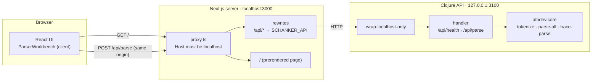
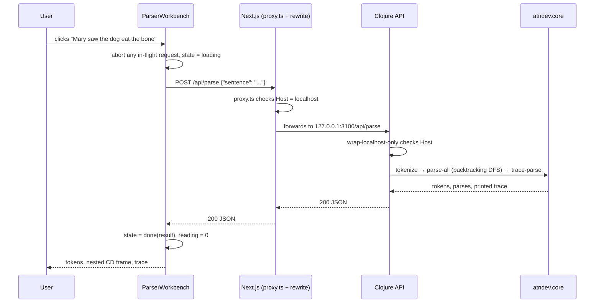
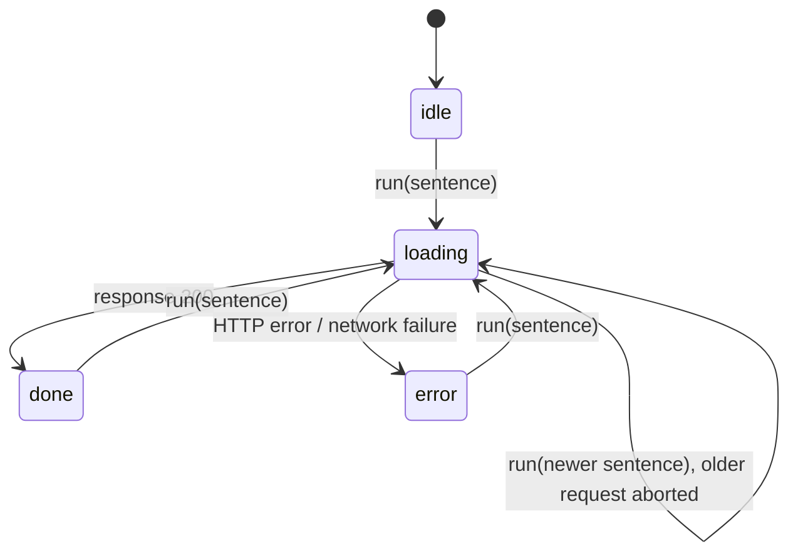

# Schanker UI: design

The web UI for [Schanker](../README.md). Pick a sample sentence (or type one) and the page shows
how the Clojure ATN parser reads it: the tokens with their lexicon categories, the resulting
**Conceptual Dependency (CD) frame** (nested when the sentence embeds an event), every alternative
parse, and the parser's step-by-step search trace.

This document covers the stack, how the browser reaches the Clojure backend, the API contract,
the React component design and, in detail, how component state is managed.

## Contents

1. [Stack](#1-stack)
2. [Architecture: invoking the Clojure backend](#2-architecture-invoking-the-clojure-backend)
3. [The API contract](#3-the-api-contract)
4. [Rendering model: Server and Client Components](#4-rendering-model-server-and-client-components)
5. [Component design](#5-component-design)
6. [State management](#6-state-management)
7. [From CD data to UI](#7-from-cd-data-to-ui)
8. [Styling and accessibility](#8-styling-and-accessibility)
9. [Security](#9-security)
10. [Running, configuring and verifying](#10-running-configuring-and-verifying)
11. [Extending the UI](#11-extending-the-ui)

## 1. Stack

| Layer | Choice | Notes |
|---|---|---|
| Framework | **Next.js 16.4** (App Router, Turbopack) | `cacheComponents` is on by default in this version. Middleware is now the `proxy.ts` file convention. |
| UI library | **React 19.3** | Function components and hooks only (`useState`, `useRef`). |
| Language | **TypeScript 5** | API response types live in [`src/lib/types.ts`](src/lib/types.ts). |
| Styling | **Tailwind CSS v4** | Loaded through the `@tailwindcss/turbopack` CSS loader in `next.config.ts`; theme tokens are in [`globals.css`](src/app/globals.css). |
| Backend | **Clojure** + http-kit + cheshire | [`backend/development/src/atndev/server.clj`](../backend/development/src/atndev/server.clj), a thin JSON layer over `atndev.core`. |

> **Next.js 16 note:** this version differs from older Next.js in ways that matter here. Read the
> guides bundled in `node_modules/next/dist/docs/` before changing routing or rendering (see
> [`AGENTS.md`](AGENTS.md)).

## 2. Architecture: invoking the Clojure backend



The browser only ever talks to **its own origin** (`localhost:3000`). Next.js forwards any
`/api/*` request to the Clojure server using a `rewrites` rule in
[`next.config.ts`](next.config.ts):

```ts
const schankerApi = process.env.SCHANKER_API ?? "http://127.0.0.1:3100";
async rewrites() {
  return [{ source: "/api/:path*", destination: `${schankerApi}/api/:path*` }];
}
```

### A parse request, end to end



### Why a rewrite proxy?

| Option | Verdict | Reasoning |
|---|---|---|
| **Rewrite proxy** (`next.config.ts` rewrites) | ✅ **chosen** | Same origin, so no CORS setup. The Clojure API stays bound to `127.0.0.1`. It's one config line, and the API is unchanged whether called by the UI, curl or a REPL. |
| Browser calls the Clojure API directly | ✗ | Needs CORS on the Clojure side. Hard-codes the API's port into client code. Exposes a second origin to the browser. |
| Route Handler (`app/api/parse/route.ts`) as a backend-for-frontend | ✗ for now | Adds a layer that only forwards JSON. It becomes the right choice if the UI ever needs to combine several backend calls, cache, or reshape responses. |
| Server Actions | ✗ | Built for form mutations. Parsing is a read, and the results are rendered interactively on the client. |

### The Clojure side

[`server.clj`](../backend/development/src/atndev/server.clj) is deliberately thin. It **adds no
parsing logic**; it calls the same functions you'd use at the REPL:

```clojure
(defn parse-result [sentence]
  (let [tokens (cd/tokenize sentence)
        parses (cd/parse-all tokens cd/cd-atn-rules)]
    {:sentence sentence :tokens tokens :cd (first parses) :parses parses
     :trace (trace-lines sentence)}))
```

The trace is **captured from `cd/trace-parse`'s printed output** (`with-out-str`), not rebuilt from
another copy of the search loop. The design notes (`CD-ATN-PARSER.md`) already warn that every
tracer copy of `parse-all`'s loop must be kept in sync by hand, so the UI reuses the existing
tracer instead of adding a fourth copy.

## 3. The API contract

| Method & path | Request | Success | Errors |
|---|---|---|---|
| `GET /api/health` | none | `200 {"status":"ok"}` | none |
| `POST /api/parse` | `{"sentence": "John gave Mary the book"}` | `200`, a `ParseResult` | `400` blank or invalid JSON · `413` over 300 characters or 30 words · `403` non-localhost Host |
| anything else | none | none | `404 {"error":"Not found"}` |

A successful `/api/parse` response:

```json
{
  "sentence": "Mary saw the dog eat the bone",
  "tokens": [{"word": "Mary", "cat": "noun"}, {"word": "saw", "cat": "verb-perceive"}, "..."],
  "cd":     {"primitive": "ATTEND", "actor": "Mary",
             "to": {"primitive": "INGEST", "actor": "dog", "object": "bone"}},
  "parses": [ "...every reading; cd is the first..." ],
  "trace":  ["TRACE \"Mary saw the dog eat the bone\" tokens= [...]", "  1  visit :S/:start ...", "..."]
}
```

- **Clojure keywords become plain strings:** `:ATRANS` → `"ATRANS"`, `:verb-give` → `"verb-give"`.
- **Sentences outside the grammar are not errors.** They return `200` with `"cd": null` and
  `"parses": []`; the trace shows where every path stopped. The UI treats this as a result.
- **Proxy failures:** if the Clojure API isn't running, Next.js returns a plain-text `500`. The client
  turns that into a message explaining how to start the API (see §6.5).

The TypeScript mirror of this contract is in [`src/lib/types.ts`](src/lib/types.ts): `ParseResult`,
`Token` and a recursive `Frame`, whose `object` and `to` can be a string or another `Frame`.

## 4. Rendering model: Server and Client Components

In the App Router, components are **Server Components by default**: they render to HTML on the
server and ship no JavaScript. Only interactive parts opt into the browser with `"use client"`.

| File | Kind | Why |
|---|---|---|
| [`app/layout.tsx`](src/app/layout.tsx) | Server | Fonts, metadata, page shell. |
| [`app/page.tsx`](src/app/page.tsx) | Server | Static header and introduction. Renders `<ParserWorkbench />`. |
| [`components/ParserWorkbench.tsx`](src/components/ParserWorkbench.tsx) | **Client** (`"use client"`) | Holds state and makes requests: the **one boundary** between server and client. |
| `SamplePicker`, `SentenceForm`, `FrameView`, `TokenStrip`, `TraceView` | Client (by import) | Only rendered inside `ParserWorkbench`, so they run in the browser without their own directive. |

**Only the boundary component carries `"use client"`.** A file with the directive is a *client
entry point*, which a Server Component could render, so Next.js requires its props to be
serializable. `SentenceForm` takes an `onSubmit` function, and marking it `"use client"` made
Next.js's TypeScript plugin warn (error 71007) that a function prop can't cross that boundary.
Components used only *inside* client code don't need the directive and can take any props.

**Build result:** `next build` reports `○ /`, so the page is **prerendered as static HTML**. It reads no
request data (no params, cookies or search params), so `cacheComponents` needs no `<Suspense>`
boundaries here. All parsing happens on the client after load, through the API.

## 5. Component design

```text
page.tsx (server)
└── ParserWorkbench (client · owns all state)
    ├── SamplePicker      — grouped sample sentences → onSelect(sentence)
    ├── SentenceForm      — free text → onSubmit(sentence)        [key = formKey]
    └── result area (aria-live)
        ├── idle / loading / error messages
        └── Result
            ├── TokenStrip   — words + lexicon categories
            ├── reading selector (only when parses.length > 1)
            ├── FrameView    — the CD frame, recursive for nested events
            ├── TraceView    — the parser's search trace (collapsible)
            └── Raw JSON     — the frame as the API sent it (collapsible)
```

| Component | Props | Responsibility |
|---|---|---|
| `ParserWorkbench` | none | State, API calls, request cancellation, layout. |
| `SamplePicker` | `selected`, `onSelect` | Renders [`SAMPLE_GROUPS`](src/lib/samples.ts) as buttons; marks the active one with `aria-pressed`. |
| `SentenceForm` | `initial`, `busy`, `onSubmit` | Controlled text input with its own draft state (see §6.4). |
| `TokenStrip` | `tokens` | One chip per word, with verb categories highlighted, since the verb's category picks the primitive. |
| `FrameView` | `frame`, `depth` | One card per frame. A role holding a frame renders another `FrameView` at `depth + 1`. |
| `TraceView` | `lines` | The trace as preformatted text in a `<details>`, with a step count in its summary. |

**Data modules:**
- [`lib/samples.ts`](src/lib/samples.ts): the 18 samples in three groups, each labelled with the
  primitive it should produce, or with why it doesn't parse yet.
- [`lib/primitives.ts`](src/lib/primitives.ts): the glosses for the 11 primitive ACTs and the role
  order and labels.
- [`lib/api.ts`](src/lib/api.ts): the only code that knows the URL or HTTP details.

## 6. State management

All interactive state lives in **one component, `ParserWorkbench`**, held in React's built-in
`useState` and `useRef`. Children are presentational: they get data and callbacks as props and own
nothing beyond, in one case, a text draft (§6.4).

### 6.1 State inventory

| State | Owner | Hook and type | Purpose |
|---|---|---|---|
| `state` | `ParserWorkbench` | `useState<State>` (a discriminated union, §6.2) | Where the current request is, plus its result or error |
| `selected` | `ParserWorkbench` | `useState<string \| null>` | Which sample is highlighted; seeds the form |
| `formKey` | `ParserWorkbench` | `useState<number>` | Incremented to remount the form when a sample is picked (§6.4) |
| `reading` | `ParserWorkbench` | `useState<number>` | Which parse to show when the search finds several |
| `inFlight` | `ParserWorkbench` | `useRef<AbortController \| null>` | The current request, so a newer one can cancel it (§6.3) |
| `text` | `SentenceForm` | `useState<string>` | The input's draft while the user types |

**Derived, not stored:**
- `frame = result.parses[reading] ?? result.cd`
- `busy = state.status === "loading"`
- The trace's step count.

Computing these on each render means they can never disagree with the data they come from.

### 6.2 The request state machine

The request status, its data and its error live in **one** value, rather than separate `isLoading`,
`result` and `error` flags:

```ts
type State =
  | { status: "idle" }
  | { status: "loading"; sentence: string }
  | { status: "done"; result: ParseResult }
  | { status: "error"; sentence: string; message: string };
```



- **Impossible states can't exist.** With separate flags, the UI can be "loading" with an old error
  still showing, or "done" with no result. A union makes each state carry exactly its own data.
- **TypeScript enforces it.** Inside `state.status === "done"`, TypeScript knows `state.result`
  exists; there's no `result!` or optional chaining.
- **"No parse" is a `done` state, not `error`.** A sentence outside the grammar is a valid answer
  (`cd: null`), so it renders as an explanation plus the trace, not as a failure.

### 6.3 Request lifecycle and race conditions

`run(sentence)` drives every request:

```ts
inFlight.current?.abort();                 // 1. cancel the previous request, if any
const controller = new AbortController();
inFlight.current = controller;             // 2. this one is now current
setReading(0);
setState({ status: "loading", sentence });
try {
  const result = await parseSentence(sentence, controller.signal);
  setState({ status: "done", result });
} catch (e) {
  if (controller.signal.aborted) return;   // 3. superseded: say nothing
  setState({ status: "error", sentence, message: … });
}
```

**Why "latest request wins" matters.** Click "John gave…" and then quickly "Mary saw…". Responses
can arrive in either order. Without cancellation, a slow first reply could land *after* the second
and overwrite it, so the page would show the frame for a sentence you've moved away from. Aborting
the old request has two effects:

1. **The browser stops** downloading the stale response.
2. **Its rejection is swallowed** by the `signal.aborted` check, so it can't touch the state.

`inFlight` is a **ref, not state**. Swapping the controller is bookkeeping that should never cause
a re-render, and a ref survives renders without triggering one.

`reading` is **reset to 0 on every new request**. Otherwise, viewing "Reading 2" of one sentence
would carry over to the next sentence, which might have only one reading.

### 6.4 The form: remount with `key` instead of syncing props

`SentenceForm` keeps its own `text` draft, so typing re-renders only the form. But picking a sample
must *replace* that draft with the sample's sentence. There are two ways to do that:

| Approach | Problem |
|---|---|
| `useEffect(() => setText(initial), [initial])` | Renders twice (stale text, then new), and re-picking the *same* sample wouldn't reset an edited draft, because `initial` hasn't changed. React's docs call this a "you might not need an effect" case. Lint here also flags `setState` in an effect (`react-hooks/set-state-in-effect`). |
| ✅ **`key={formKey}`** with `formKey` incremented on every pick | A new key gives React a **new component instance**, so `useState(initial)` starts fresh from the sample. One render, no effect, and re-picking the same sample still resets the draft. |

```tsx
function pickSample(sentence: string) {
  setSelected(sentence);
  setFormKey((k) => k + 1);   // remount SentenceForm with initial = sentence
  run(sentence);
}
```

### 6.5 Errors: normalized at the API boundary

[`lib/api.ts`](src/lib/api.ts) turns every failure into an `ApiError(status, message)` with a
readable message, so components never parse HTTP details:

| Failure | What the user sees |
|---|---|
| Clojure API returned `{"error": …}` (400, 403, 413) | That message |
| Clojure API not running (the proxy's plain-text 500) | "The Schanker API isn't responding. Start it with: `cd backend && clojure -M:dev:server`" |
| Network failure reaching Next.js | "Can't reach the app server." |
| Request aborted | Nothing: the error is re-thrown as `AbortError` and ignored by `run` |

### 6.6 Why no state library

There's no Redux, Zustand, React Context or TanStack Query, deliberately:

- **One owner, a shallow tree.** All state lives in one component, at most two levels above its
  readers. Passing props is clearer than a store.
- **One request type, one consumer.** TanStack Query's caching and deduplication would be welcome
  with several views sharing server data. Here, `AbortController` and the union cover the need in
  about 20 lines.
- **No shared state between pages.** There's one page, and nothing needs to survive navigation.

**Revisit when:**
- **More views read parse results** (e.g. a scripts or causal-chain view): lift the state into a
  Context, or adopt TanStack Query to cache by sentence.
- **Results should be shareable:** move the sentence into the URL (`?s=…`). Note that under
  `cacheComponents`, `useSearchParams` requires a `<Suspense>` boundary.

## 7. From CD data to UI

- **Recursive frames.** `FrameView` renders a frame's primitive (with its gloss from
  `primitives.ts`), then each filled role in a fixed order: actor, action, object, from, to. If a
  role's value is an object, it's an embedded event and renders as a nested `FrameView`. Accent
  colours cycle by depth (indigo, emerald, amber), so "John said [Mary left]" reads as two visibly
  nested frames.
- **Frames without a primitive.** The grammar's `:CLAUSE` sub-network ("Mary listened to [the dog
  snore]") produces `{actor, action}` with no primitive. `FrameView` labels it `EVENT`, with the gloss
  "an intransitive event".
- **Tokens.** The tokenizer's output is shown as is. Verb categories (`verb-*`) are highlighted
  because they select the primitive: `saw` → `verb-perceive` → ATTEND.
- **Several readings.** When the backtracking search returns more than one parse, a "Reading 1 / 2 /
  …" selector appears. None of the current samples is ambiguous, so it's there for sentences you
  type.

## 8. Styling and accessibility

**Styling:**
- **Tailwind v4** utilities, with colours from CSS variables in `globals.css`.
- **Light and dark** follow the OS setting (`prefers-color-scheme`).
- **Fonts:** Geist Sans and Geist Mono are loaded by `next/font` and applied through `--font-sans`.
  The scaffold's hard-coded `Arial` was overriding them and has been removed.
- **Layout:** a two-column grid on medium screens and up, with the sample list sticky and scrolling
  on its own; a single column on phones.

**Accessibility:**
- The result area is an `aria-live="polite"` region, so screen readers announce new results.
- Errors use `role="alert"`.
- Sample and reading buttons expose `aria-pressed`, and the input has a label (visually hidden).
- Tooltips on role names explain each role, e.g. "To: recipient, destination or what is perceived".
- The trace and the raw JSON use native `<details>`, so they're keyboard-accessible without
  JavaScript.

## 9. Security

The API runs the parser on whatever text it receives and has no login, so both servers are locked
to your machine:

| Layer | Defence |
|---|---|
| Clojure API | Listens on `127.0.0.1` only. `wrap-localhost-only` rejects any `Host` that isn't localhost. Input is capped at 300 characters and 30 words, which bounds the backtracking search. |
| Next.js | [`src/proxy.ts`](src/proxy.ts) rejects non-localhost `Host` headers **before** the `/api` rewrite runs. |

**Why check `Host` when everything is on localhost?** **DNS rebinding:** a malicious web page can
re-point its own domain name at `127.0.0.1` and call these servers from your browser as if it were
the same site, so CORS doesn't stop it. Browsers never let scripts set `Host`, though, so the
attacker's domain is still visible there. Both layers check it: the browser's real `Host` at
Next.js, and the forwarded `Host` at the API.

## 10. Running, configuring and verifying

```bash
# Terminal 1: the Clojure API (127.0.0.1:3100)
cd backend && clojure -M:dev:server

# Terminal 2: the UI (http://localhost:3000)
cd frontend && npm install && npm run dev
```

| Variable | Where | Default |
|---|---|---|
| `SCHANKER_PORT` | Clojure API: port | `3100` |
| `SCHANKER_API` | Next.js: where `/api/*` is forwarded | `http://127.0.0.1:3100` |

**Checks** (all passing when this document was written):

| Command | Covers |
|---|---|
| `cd backend && clojure -M:dev:test` | 54 tests, including [`server_test.clj`](../backend/development/test/atndev/server_test.clj): response shape, nested frames, no-parse results, input limits, localhost guard |
| `npm run typecheck` · `npm run lint` · `npx next build` | Types, lint rules, production build (`/` prerendered as static) |

**Checked by hand:** all 18 samples sent through the Next.js proxy return the labelled primitive,
or no parse for the 3 paraphrases. Rebinding requests get 403 at both layers. With the API stopped,
the UI shows the "start the API" message. The rendered page hasn't been checked in a browser by
automated tests.

## 11. Extending the UI

- **New samples:** add them to [`lib/samples.ts`](src/lib/samples.ts). A group needs only `title`,
  `description` and `samples`.
- **New grammar coverage** (e.g. "received" as ATRANS) needs no UI change. Once the backend parses it,
  move the sample from "Outside the grammar" into a supported group, with its `expect` primitive.
- **Higher layers** (scripts, causal chains, plans, the goal monitor):
  1. Add an endpoint in `server.clj` that wraps the existing function, e.g. `s/understand` or
     `s/causal-chain`.
  2. Add its types to `types.ts` and a fetch function to `api.ts`.
  3. Add a view component.

  If the new view shares parse results with the current one, follow §6.6's advice about lifting
  state.
